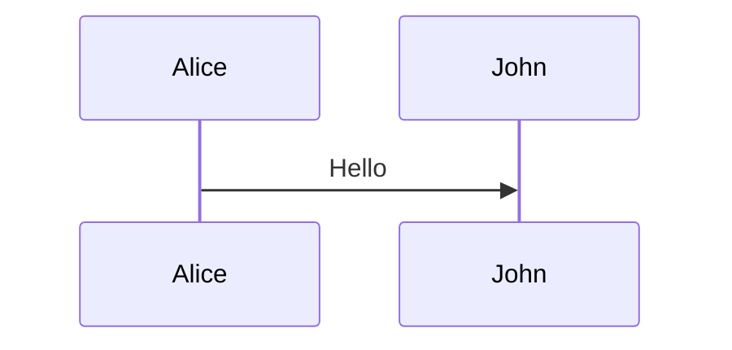

# コード ブロックと図のキャプション

図やコード ブロックのキャプションは、ブロックの直後に空行を挟んで `Figure:` 行または `CodeBlock:` 行を記述して指定します。  
キャプションをフェンスや画像属性の外に出す記法です。  
図とコード ブロックのキャプションはブロックの後ろに置き、ブロックの下に表示します。  
表のキャプション ([表の `Table:`](table-caption.md)) は表の前に置き、表の上に表示します。ソース上の位置と表示位置が一致します。

````text


Figure: 接続シーケンス {#fig:seq-open}
````

```markdown


Figure: システム構成 {#fig:arch}
```

フェンスには言語名だけを記載するため、GitHub などの Web 表示でも図の描画とシンタックス ハイライトが機能します。

## 適用範囲

対象ブロックの種類に応じて、`Figure:` と `CodeBlock:` を使い分けます。

Table: 対象ブロック種別に応じたキャプション記法とラベル接頭辞

| 対象ブロックの種類 | 推奨記法 | キャプションの扱い | ラベルの接頭辞 |
|---|---|---|---|
| Mermaid | `Figure:` | 図のキャプション | `fig:` |
| PlantUML | `Figure:` | 図のキャプション | `fig:` |
| 画像 1 個だけの段落 | `Figure:` | 図のキャプション | `fig:` |
| ソース コード全般 (`c`、`makefile`、`text` など、言語指定なしを含む) | `CodeBlock:` | コード ブロックのキャプション | `lst:` |

図と判定するコード ブロック言語の一覧は `bin_internal/diagram-languages.txt` で一元管理しています。新しい図言語を追加する場合は、この一覧へ言語名を追加してください。

### 対象外の組み合わせと警告

- 図のフェンス (Mermaid / PlantUML) に対して `CodeBlock:` を指定した場合、および通常のコード ブロックに対して `Figure:` を指定した場合は、キャプションとして採用せず、標準エラー出力へ警告を出したうえで通常の段落として出力します。
- 画像 1 個だけの段落の後に `CodeBlock:` を記述した場合は、キャプションとして扱わず通常の段落として出力します (警告なし)。
- 正しい組み合わせにおいてキャプション行の種別とラベルの接頭辞が一致しない場合 (`Figure:` に `{#lst:...}`、通常コード ブロックの `CodeBlock:` に `{#fig:...}` を指定した場合) は、標準エラー出力へ警告を出したうえでキャプションとラベルを採用します。

## 記法

- 対象は直前のコード ブロックまたは画像 1 個だけの段落だけです。直前が対象ブロックでない `Figure:` / `CodeBlock:` 段落は、通常の段落として出力されます。
- キャプションは `Figure:` または `CodeBlock:` に続けて記述します。前後の空白は除去されます。
- 末尾の `{#fig:xxx}` または `{#lst:xxx}` は省略可能なラベルです。ラベルを付けた場合のみ、pandoc-crossref による採番と `[@fig:xxx]` / `[@lst:xxx]` 形式の相互参照の対象になります。
- キャプションを段落内で改行すると、HTML、DOCX、MkDocs で段落内改行を保持し、複数行で出力されます。

### 画像に対する Figure: と代替テキスト

- 代替テキストをそのままキャプションにする従来の書き方 (``) も、正式な書き方として引き続き使用できます。`Figure:` 行は、代替テキストと異なる題名を付ける場合や、複数行のキャプション・ラベルを付けたい場合に使用します。
- 代替テキストのある画像に `Figure:` 行を付けた場合、`Figure:` 行の文字列を図のキャプションとして採用し、元の代替テキストは画像の `alt` 属性として保持します。
- 代替テキストが空の画像 (``) に `Figure:` 行を付けた場合は図として扱い、画像の `alt` 属性にもキャプションの文字列を設定します。
- 画像側の属性ラベル (`{#fig:a}`) と `Figure:` 行のラベル (`{#fig:b}`) の双方が指定されている場合は、警告を出したうえで `Figure:` 行のラベルを採用します。

## 処理の流れ

キャプションの正規化と描画を分離しています。

1. `codeblock-caption-line.lua` が `Figure:` / `CodeBlock:` 段落を取り込み、直前のコード ブロックの `caption` 属性と identifier、または画像の `Figure` 要素へ畳み込みます。`Table:` 段落は扱いません ([表のキャプション](table-caption.md) を参照)。
2. 描画は種類ごとに分かれます。
    - Mermaid は `mermaid.lua` が処理します。HTML 出力では図を画像化せず、`div.docsfw-mermaid` 内に描画元を保持する Figure として出力します。それ以外の出力形式では画像化した Figure を出力します。
    - PlantUML は `plantuml.lua` が処理します。`caption` 属性がない場合は、PlantUML ソース内の `caption` 行や `@startuml` のタイトルをキャプションとして採用します。
    - 画像は Pandoc 標準の `Figure` 要素として処理され、ラベルがある場合は pandoc-crossref が図として採番します。
    - それ以外のコード ブロックは `codeblock-caption.lua` が処理し、`custom-style` が `Source Code Caption` の段落をコード ブロックの直後に出力します。
3. ラベル付きのコード ブロックは pandoc-crossref がリストとして採番します。pandoc-crossref はキャプションをコード ブロックの上に配置するため、`listing-caption-style.lua` が末尾へ移動し、`Source Code Caption` を付与します。

Mermaid と PlantUML は、キャプションのインライン列を一つの段落にまとめて Figure へ渡します。  
通常のコード ブロックでは、`listing-caption-style.lua` が pandoc-crossref によって `SoftBreak` へ変換された改行を `LineBreak` へ戻します。  
どちらも DOCX で余分な段落を作らず、キャプションの段落内改行を保持します。

フィルターの適用順序は次の通りです。`codeblock-caption-line.lua` は `plantuml.lua` より前、`listing-caption-style.lua` は pandoc-crossref より後に置く必要があります。

```text
fix-line-break.lua
  -> codeblock-caption-line.lua
  -> plantuml.lua
  -> mermaid.lua
  -> (中略)
  -> codeblock-caption.lua
  -> pandoc-crossref
  -> listing-caption-style.lua
```

## pandoc-crossref がない場合

pandoc-crossref はオプションであり、導入していない環境でも発行できます。  
`pub_markdown_core.sh` は pandoc-crossref の有無をメタデータ `docsfw-crossref` で Lua フィルターへ通知します。

- pandoc-crossref がある場合、ラベル付きのコード ブロックは `codeblock-caption.lua` では処理せず、pandoc-crossref に委譲します。
- pandoc-crossref がない場合、ラベル付きのコード ブロックも `codeblock-caption.lua` が処理します。採番と相互参照は行われず、キャプションだけが出力されます。

## 採番の日本語ラベル

pandoc-crossref のラベルは `set-meta.lua` が日本語に設定します。文書のフロント マターで上書きできます。

Table: pandoc-crossref 採番用メタデータと日本語既定値

| メタデータ | 既定値 | 用途 |
|---|---|---|
| `figureTitle` | 図 | 図のキャプションの接頭辞 |
| `tableTitle` | 表 | 表のキャプションの接頭辞 |
| `listingTitle` | リスト | リストのキャプションの接頭辞 |
| `figPrefix` | 図 | 本文中の図の参照の接頭辞 |
| `tblPrefix` | 表 | 本文中の表の参照の接頭辞 |
| `lstPrefix` | リスト | 本文中のリストの参照の接頭辞 |

## 廃止した記法

次の 2 つの記法は廃止しました。いずれも Pandoc 固有の拡張であり、GitHub などの Web 表示で言語の判定に失敗するためです。

Table: 廃止されたコード ブロック記法と代替記法の一覧

| 廃止した記法 | 置き換え |
|---|---|
| ` ```{.mermaid caption="キャプション"} ` | ` ```mermaid ` と `Figure: キャプション` |
| ` ```text:Sample.txt ` | ` ```text ` と `CodeBlock: Sample.txt` |

廃止した `caption` 属性が残っている場合は、標準エラー出力へ警告を出力したうえで属性を破棄します。キャプションは出力されません。  
`Figure:` 行または `CodeBlock:` 行を併記している場合は、警告を出力したうえでキャプション行の値を採用します。

## サンプル

- [コード ブロック キャプションのサンプル](sample/codeblock-caption.md)
- [Mermaid キャプションのサンプル](sample/mermaid-caption.md)
- [相互参照のサンプル](sample/crossref.md)
