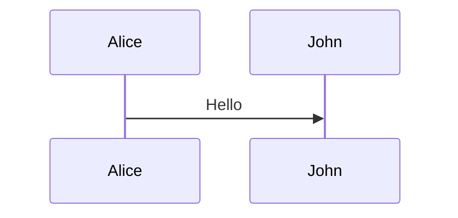

<!--
生成元: agree-before-implement スキル
文書種別: 最終仕様 (design)
最終更新エージェント: agy / セッション ID: 24b4b963-1c05-47da-b908-438ccdec6b76
上流文書: `261114-figure-caption-line-discussion.md` (検討用 Markdown)。削除されている場合があります。
再開手順: このファイルを開いたエージェントは、作業の前に agree-before-implement スキルを読み込んでください。上流文書が存在する場合は、上流文書の再開手順に従って進行位置を確認し、判断の経緯を上流文書の Q&A で確認します。存在しない場合は、この文書を単体の最終仕様として扱います。最終更新エージェントのセッション情報が参照可能であれば再開時のコンテキストとして利用し、別エージェントからの引き継ぎや担当変更によりセッションが見つからない場合も異常とせず、文書の記載から継続してください。
-->

# 図のキャプション行 Figure: の導入 最終仕様

## 概要

Markdown における図 (PlantUML / Mermaid のフェンス コード ブロック、および画像 1 個だけの段落) のキャプション指定として、`Figure:` 行を導入する。  
これにより、キャプションの接頭辞は対象ブロックの種類と一致する体系になる。

| 対象ブロック | 推奨キャプション行 | ラベル接頭辞 | 表示位置 |
| --- | --- | --- | --- |
| 表 | `Table:` | `tbl:` | 表の上 |
| 図 (PlantUML / Mermaid フェンス、画像) | `Figure:` | `fig:` | 図の下 |
| ソース コード全般 (`c`、`text`、言語指定なし等) | `CodeBlock:` | `lst:` | コード ブロックの下 |

> [!NOTE]
> `Figure:` は図のキャプションを原文 (GitHub 等) でも自然な意味で読めるようにするための記法であり、既存の `CodeBlock:` 記法 (コード ブロック用) と `Table:` 記法 (表用) に並列して加わる。

## 記法と動作仕様

### 基本構文

ブロックの直後に空行を挟んで `Figure:` 行を記述する。

````markdown


Figure: 接続シーケンス {#fig:seq-open}
````

```markdown


Figure: システム構成 {#fig:arch}
```

- 前後の空白は除去する。
- 末尾の `{#fig:xxx}` は省略可能なラベルであり、pandoc-crossref による採番および `[@fig:xxx]` 形式の相互参照の対象となる。
- 段落内で改行すると、HTML・DOCX・MkDocs のいずれでも段落内改行を保持し、複数行で出力する。
- 直前が対象ブロック (コード ブロックまたは画像 1 個だけの段落) でない `Figure:` 段落は、通常の段落として出力する。

### 対象ブロックごとの判定と互換・警告規則

| 直前のブロック | `Figure:` 行 | `CodeBlock:` 行 |
| --- | --- | --- |
| 図のフェンス (`plantuml` / `mermaid`) | 正式な図キャプションとして採用 (警告なし) | 互換のため図キャプションとして採用 (文書上は非推奨。警告は出さない) |
| 通常のコード ブロック | 警告を出力したうえでキャプションとして採用 | 正式なコード キャプションとして採用 (警告なし) |
| 画像 1 個だけの段落 | 正式な図キャプションとして採用 (警告なし) | 現行どおり通常の段落として出力 (警告なし) |
| 上記以外のブロック | 通常の段落として出力 (警告なし) | 現行どおり通常の段落として出力 (警告なし) |

> [!IMPORTANT]
> ラベルの接頭辞がキャプション行の種別と一致しない場合 (`Figure:` に `{#lst:...}`、または通常コード ブロックの `CodeBlock:` に `{#fig:...}` を指定した場合) は、標準エラー出力へ警告を出力したうえでキャプションとラベル自体は採用する。なお、図フェンス直後の互換 `CodeBlock:` における `{#fig:...}` は移行互換のため警告の対象外とする。

### 画像に対する Figure: 行の詳細規則

Pandoc 3.11 (`implicit_figures` 有効) では、代替テキストが空でない画像 1 個だけの段落が `Figure` ブロックとなり、代替テキストが空の画像 1 個だけの段落は `Para` (`Image` 1 個を含む) となる。MkDocs 前処理 (`stage_livedocs.py`) でも同等の規則を適用する。

1. **キャプションの優先順位**: 代替テキストのある画像に `Figure:` 行を付けた場合、`Figure:` 行の本文をキャプションとして採用し、元の代替テキストは画像の `alt` 属性として保持する。
2. **代替テキストが空の場合**: `` に `Figure:` 行を付けた場合、図 (`<figure>`) として扱い、画像の `alt` 属性にはキャプションの文字列 (ラベルを除いた本文) を設定する。
3. **ラベルの優先順位**: 画像側の属性 `{#fig:a}` と `Figure:` 行のラベル `{#fig:b}` の双方が指定されている場合は、標準エラー出力へ警告を出力したうえで `Figure:` 行のラベルを採用する。片方のみの場合はそのラベルを採用する。
4. **従来の代替テキストによるキャプション**: `` のみの記述も引き続き正式な書き方として維持する。`Figure:` 行は、代替テキストと異なる題名を付ける場合、複数行キャプションやラベルを使う場合などに使用する。

## アーキテクチャーと設計

### 図言語一覧の一元化

現在、図と判定するフェンス言語 (`plantuml`、`mermaid`) は、描画フィルター (`plantuml.lua`、`mermaid.lua`) と MkDocs 前処理 (`stage_livedocs.py` の `_DIAGRAM_FENCE_RE`) に分散している。

- 一元化のため、設定ファイル `framework/docsfw/bin_internal/diagram-languages.txt` を新設し、1 行 1 言語名 (`#` 以降はコメント、空行無視) で `plantuml` と `mermaid` を定義する。
- Pandoc フィルター側 (`codeblock-caption-line.lua`) は `PANDOC_SCRIPT_FILE` 基準の相対パス (`../diagram-languages.txt`) からこの一覧を読み込む。
- MkDocs 前処理側 (`stage_livedocs.py`) は自スクリプト位置基準の相対パス (`../../bin_internal/diagram-languages.txt`) から読み込み、図フェンス判定の正規表現を動的に構築する。
- 言語一覧ファイルの読み込みに失敗した場合はフォールバックを許さず明示的にエラーとし、設定不整合を防ぐ。

### Pandoc フィルター (codeblock-caption-line.lua) の設計

1. **対応接頭辞の拡張**: `CAPTION_PREFIX` の単一定義から、`CodeBlock:` と `Figure:` の双方を判定する構造へ変更する。
2. **コード ブロックへの適用**:
    - 直前が `CodeBlock` の場合、キャプション本文とラベルを抽出して `caption` 属性・`identifier`・`SOURCE_MARK` を設定する。
    - 図言語一覧に含まれない言語に対して `Figure:` が使われた場合は、標準エラー出力へ警告を出す。
    - キャプション行の種別とラベル接頭辞の不一致 (`Figure:` と `lst:`、`CodeBlock:` と `fig:`) を検出した場合は、標準エラー出力へ警告を出す。
3. **画像ブロックへの適用**:
    - 直前が「`Figure` ブロック (内部に `Image` 1 個のみを持つ `Plain` または `Para` を含む)」または「`Para` ブロック (内容が `Image` 1 個のみ)」である場合に、`Figure:` 行を受け付ける (`CodeBlock:` 行は受け付けない)。
    - キャプション本文のインライン列は `LineBreak` / `SoftBreak` を保持し、末尾の `{#...}` ラベルを除去したうえで `pandoc.Caption` の `Plain` ブロックへ設定する。
    - 対象が `Para` の場合は `pandoc.Figure` を生成して置き換える。その際、内部 `Image` の `caption` (代替テキスト) が空であれば、キャプション本文のインライン列を `Image.caption` にも設定する。
    - ラベルが画像属性 (`Figure.identifier` または `Image.identifier`) と `Figure:` 行の双方に存在する場合は、警告を出力して `Figure:` 行のラベルを `Figure.identifier` に設定し、重複を避けるため `Image.identifier` は空にする。
4. **フィルター適用順**: `pub_markdown_core.sh` の適用順 (`codeblock-caption-line.lua` → `plantuml.lua` → `mermaid.lua` → ... → `codeblock-caption.lua` → `pandoc-crossref`) は変更しない。

### MkDocs 前処理 (livedocs/bin/stage_livedocs.py) の設計

1. **正規表現と状態管理の拡張**:
    - `_CAPTION_RE` を `^(?P<indent>[ \t]*)(Table|CodeBlock|Figure):[ \t]*(.*)$` 相当へ拡張する。
    - 図フェンス (`diagram_block`) に加え、直前に閉じた画像 1 個だけの段落 (`image_block`: `at_paragraph_start` かつ `at_paragraph_end` で `_IMAGE_ONLY_RE` に一致するもの、行頭のものに限定) を追跡する。
2. **図フェンスの直後**:
    - `CodeBlock:` と `Figure:` の双方を受け付け、`<figure>` で包む。
    - 図以外のコード ブロックの直後に `Figure:` が書かれた場合は、標準エラー出力へ警告を出したうえで `.docsfw-caption` 段落として出力する (ラベル接頭辞不一致も同様に警告する)。
3. **画像段落の直後**:
    - `Figure:` 行のみを受け付け (`CodeBlock:` 行は通常の段落として残す)、画像段落の行を `<figure>` と `<figcaption>` で包み替える。
    - 画像側の代替テキストが空の場合は、`<figcaption>` に渡すキャプション文字列 (複数行の場合は連結した文字列) を画像の `` の `alt` 部分に埋め込む。代替テキストが非空の場合はそのまま保持する。
    - 画像属性と `Figure:` 行のラベルが両方ある場合は、標準エラー出力へ警告を出して `Figure:` 行のラベルを採用する (画像側の `{#...}` は除去する)。
    - `convert_implicit_figures()` が `<figure>` 内の画像行を二重に `<figure>` 化しないよう、`convert_implicit_figures()` 側で `<figure` 〜 `</figure>` ブロックの内部をスキップする処理を追加する。

### 既存文書の書き換え対象

`docs/prompts/` 配下の検討記録を除き、図 (PlantUML / Mermaid) のフェンスに対して `CodeBlock:` を使用している全ファイルを `Figure:` へ書き換える。

- `framework/docsfw/` 内の文書・サンプル・テスト (`test-html-diagrams.js` 等)
- 他フレームワーク (`framework/doxyfw/`、`framework/makefw/`、`framework/testfw/`)
- 各 `app/` およびルート `README.md`
- スキル同期元 (`app/general/.agents/skills/agree-before-implement/SKILL.md`) を書き換えたうえで、同期スクリプトを用いて `.agents/skills/` へ同期する。

> [!NOTE]
> `bin_internal/pandoc-filters/` 内の実装コメントおよび `bin_test/test_plantuml_caption_priority.py` 等のテストにおいて、`CodeBlock:` 互換動作そのものを検証するテスト ケースは互換テストとして維持または整理し、図の標準記法を検証するテストは `Figure:` へ更新する。

## 永続的知見の反映計画

検討・設計を通じて確定した恒久仕様は、作業実施フェーズで次の正本およびコード コメントへ反映する。

1. [codeblock-caption.md](../../codeblock-caption.md):
    - 図 (Mermaid / PlantUML / 画像) の標準キャプション記法としての `Figure:` の仕様、適用範囲表、処理の流れ、および画像の代替テキストとの使い分け・優先順位を記載する。
    - 図のフェンスに対する `CodeBlock:` は互換動作として残すが非推奨である旨を明記する。
    - 図と判定する言語の一覧を追加する場合の更新箇所 (`bin_internal/diagram-languages.txt`) を記載する。
2. [codeblock-caption-line.lua](../../../bin_internal/pandoc-filters/codeblock-caption-line.lua) および [stage_livedocs.py](../../../livedocs/bin/stage_livedocs.py):
    - ファイル先頭コメントおよび関数 docstring に、`Figure:` と `CodeBlock:` の責務、警告条件、画像 `implicit_figures` との連携仕様を簡潔に記述する。

## 受入条件と検証計画

以下のすべてを満たすことをもって完了とする。

1. **単体テストの追加と全件合格**:
    - `framework/docsfw/bin_test/` に、`Figure:` 行の正常系 (PlantUML / Mermaid / 画像)、警告系 (通常コード ブロックへの `Figure:`、ラベル接頭辞不一致、画像ラベル重複)、画像の代替テキスト有無・複数行キャプションを検証するテストを追加し、パスすること。
    - `framework/docsfw/livedocs/bin_test/test_stage_livedocs.py` に、`Figure:` 行による図フェンス・画像の `<figure>` 化、二重 `<figure>` 防止、警告出力を検証するテストを追加し、パスすること。
2. **局所発行での確認**:
    - `framework/docsfw/docs/sample/` 等のサンプル文書を Pandoc (HTML / DOCX) および MkDocs で局所発行し、図のキャプション、相互参照、画像の `alt` 属性、複数行改行が意図どおり出力されること。
3. **既存文書の書き換えと整合確認**:
    - `docs/prompts/` を除く全リポジトリで図フェンス直後の `CodeBlock:` が残っていないことを検索で確認すること。
    - スキル同期 (`app/general/.agents/skills/` → `.agents/skills/`) が完了していること。
4. **機械的検証**:
    - 変更したすべての Markdown ファイルに対して `text_style_jp.py --dry-run` がエラー 0 件で通ること。
